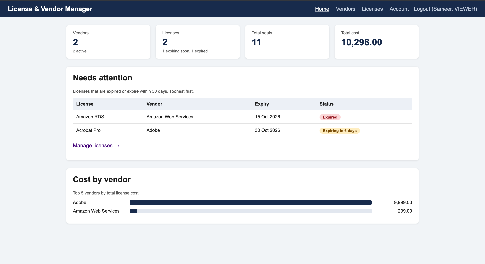
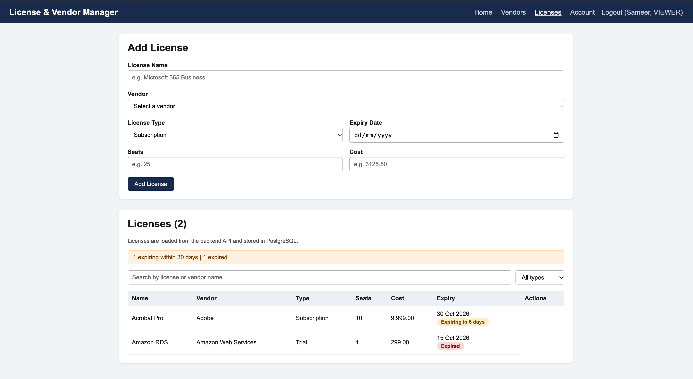

# License & Vendor Manager

A full-stack web application for tracking software vendors and their licenses: who you buy from, how many seats you have, what it costs, and what is about to expire.

**Live demo:** https://license-vendor-manager.onrender.com
*(Free hosting: the first visit after a period of inactivity can take about a minute to wake up.)*

**Demo login (read-only):** `Sameer` / `sameer1234`

>  
>  

---

## Features

**Vendors**
- Add, edit, delete, search and filter by status
- Duplicate names are rejected (case-insensitive)
- A vendor that still has licenses cannot be deleted

**Licenses**
- Each license belongs to a vendor (Subscription, Perpetual or Trial)
- Seats, cost and expiry date, with rules that depend on the type (Perpetual licenses never expire)
- Expiry status badges: Active, Expiring soon (30 days), Expired
- Search by license or vendor name, filter by type

**Dashboard**
- Totals for vendors, licenses, seats and cost
- "Needs attention" list of expired and soon-to-expire licenses
- Cost by vendor chart

**Authentication and roles**
- Login with JWT tokens, passwords stored as BCrypt hashes
- Two roles: **ADMIN** (full access) and **VIEWER** (read-only)
- Admins manage users: create, change role, reset password, delete
- Any user can change their own password
- Safety rules: you cannot delete yourself and the last admin cannot be removed or demoted
- Roles are checked on the server for every request, so hiding buttons in the UI is only a convenience

---

## Tech stack

| Layer | Technology |
|---|---|
| Frontend | HTML, CSS, vanilla JavaScript |
| Backend | Java 21, Spring Boot, Spring Web, Spring Data JPA, Spring Security |
| Database | PostgreSQL |
| Auth | JWT (jjwt), BCrypt |
| Testing | JUnit 5, Mockito, Spring MockMvc |
| DevOps | Docker, Docker Compose, Caddy (production compose), GitHub |
| Hosting (demo) | Render (app) and Neon (PostgreSQL) |

---

## Architecture

```
Browser (HTML/CSS/JS)
        |
        |  JSON over HTTP, "Authorization: Bearer <token>"
        v
Spring Boot
  Security filter  ->  checks the token and the user's role
  Controller       ->  maps URLs to service calls, validates input
  Service          ->  business rules
  Repository       ->  database access (Spring Data JPA)
        |
        v
PostgreSQL
```

- Controllers only handle HTTP. Business rules live in services.
- Input rules are declared with validation annotations on request classes.
- One global exception handler returns the same error JSON for every failure:
  `status`, `error`, `message`, `errors` (per-field) and `timestamp`.
- In the deployed version, Spring Boot serves the pages and the API from the same address, so no CORS configuration is needed.

---

## Project structure

```
.
├── index.html, login.html, vendors.html,
│   licenses.html, account.html, users.html
├── css/style.css
├── js/                       auth.js (shared), page scripts
├── Dockerfile                builds pages + API into one image (used by Render)
└── Backend/license-manager/
    ├── pom.xml
    ├── Dockerfile            backend only (used by docker-compose)
    ├── docker-compose.yml    development: database, backend, nginx frontend
    ├── docker-compose.prod.yml   production-style: Caddy with HTTPS
    ├── Caddyfile
    ├── .env.example
    ├── requests.http         API requests for the VS Code REST Client
    └── src/
        ├── main/java/com/example/license_manager/
        └── test/java/com/example/license_manager/
```

---

## Run locally

Requirements: JDK 21, Docker Desktop, VS Code with the Live Server extension.

**Option 1: backend with Maven, pages with Live Server (best for development)**

1. Start the database:
   ```
   cd Backend/license-manager
   docker compose up -d db
   ```
2. Start the backend:
   ```
   ./mvnw spring-boot:run
   ```
3. In VS Code, right-click `login.html` and choose **Open with Live Server**.
4. Sign in as `admin` / `admin123`.

The admin account is created on first startup, only when there are no users. `admin123` is a **development default only**.

**Option 2: everything in Docker**

```
cd Backend/license-manager
docker compose up --build -d
```

Open http://localhost:3000. Do not run this at the same time as Option 1, because both use port 8080.

Stop with `docker compose down`. Never add `-v`, because that deletes the database data.

---

## Configuration

Settings come from environment variables, with development defaults.

| Variable | Purpose | Default (dev only) |
|---|---|---|
| `DB_URL` | JDBC URL of the database | `jdbc:postgresql://localhost:5432/license_manager` |
| `DB_USERNAME` | Database user | `license_user` |
| `DB_PASSWORD` | Database password | `license_pass` |
| `JWT_SECRET` | Key that signs tokens (32+ characters) | a development value |
| `ADMIN_USERNAME` | First admin account | `admin` |
| `ADMIN_PASSWORD` | First admin password | `admin123` |
| `CORS_ORIGINS` | Allowed page origins (comma separated) | local dev addresses |
| `PORT` | Server port | `8080` |

**Always set your own `JWT_SECRET`, `ADMIN_PASSWORD` and `DB_PASSWORD` before deploying.** Generate a secret with `openssl rand -base64 48`. Never commit real secrets: `.env` files are ignored by Git.

---

## API

All endpoints except login require `Authorization: Bearer <token>`.

**Auth**

| Method | URL | Access | Purpose |
|---|---|---|---|
| POST | `/api/auth/login` | public | Get a token |
| GET | `/api/auth/me` | any user | Current username and role |
| POST | `/api/auth/change-password` | any user | Change own password |

**Vendors and licenses**

| Method | URL | Access |
|---|---|---|
| GET | `/api/vendors`, `/api/vendors/{id}` | ADMIN, VIEWER |
| POST, PUT, DELETE | `/api/vendors`, `/api/vendors/{id}` | ADMIN |
| GET | `/api/licenses`, `/api/licenses/{id}` | ADMIN, VIEWER |
| POST, PUT, DELETE | `/api/licenses`, `/api/licenses/{id}` | ADMIN |

**Users (admin only)**

| Method | URL | Purpose |
|---|---|---|
| GET | `/api/users` | List users |
| POST | `/api/users` | Create a user |
| PUT | `/api/users/{id}/role` | Change role |
| PUT | `/api/users/{id}/password` | Reset password |
| DELETE | `/api/users/{id}` | Delete a user |

Status codes: `200`/`201`/`204` success, `400` validation error, `401` not logged in or token expired, `403` logged in but not allowed, `404` not found, `409` conflict (duplicate or still in use).

Example error:

```json
{
  "status": 400,
  "error": "Bad Request",
  "message": "Vendor name is required. Please enter a valid email address.",
  "errors": { "name": "Vendor name is required.", "email": "Please enter a valid email address." },
  "timestamp": "2026-10-24T05:00:00Z"
}
```

---

## Tests

```
cd Backend/license-manager
./mvnw test
```

- **Service tests** (JUnit + Mockito): business rules, with fake repositories, no database needed.
- **Controller tests** (MockMvc): URLs, status codes and the error format.

---

## Deployment

The live demo runs on free tiers:

- **Render** runs the root `Dockerfile`, which packages the pages and the API into one service.
- **Neon** provides PostgreSQL.
- Secrets are set as environment variables in Render, never stored in the repository.

`docker-compose.prod.yml` is a self-hosted alternative (for a VPS): Caddy handles HTTPS, only ports 80 and 443 are exposed, and the database and backend are reachable only inside Docker.

---

## Security notes

- Passwords are hashed with BCrypt. Tokens are signed, not encrypted, and contain only the username.
- The server loads the user from the database on every request, so deleting a user or changing a role takes effect immediately.
- The server enforces roles. The UI hides admin controls but does not rely on that.
- Pages insert user data with `textContent`, never as HTML.

**Known limitations**
- No login rate limiting yet.
- Tokens are kept in `localStorage`.
- Database tables are managed by Hibernate (`ddl-auto=update`). A migration tool such as Flyway would be the next step for a real product.
- The free hosting tier sleeps when idle.

---

## Roadmap

- GitHub Actions: run tests on every push
- Login rate limiting
- Tests for authentication and user rules
- Flyway database migrations
- Email alerts for expiring licenses
- CSV export

---

## What I learned

Building this end to end: REST API design, layered Spring Boot structure, validation and consistent error handling, JWT authentication and role-based authorization, JPA relationships (one vendor to many licenses), Docker and Docker Compose, unit and web-layer testing, and deploying with environment-based secrets.